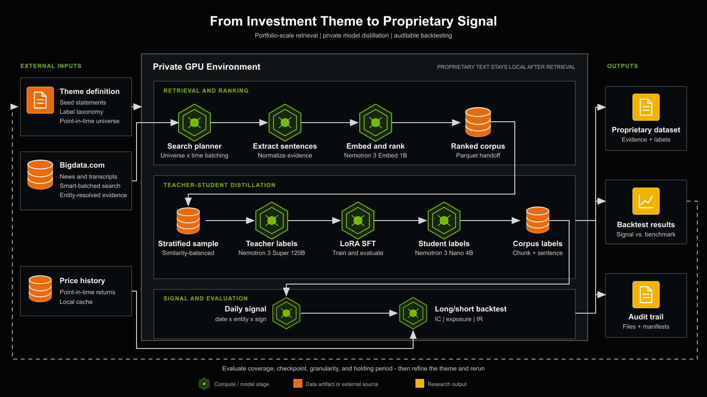

# Bigdata Dataset Generation

Turn a plain-language description of a financial theme into a backtested trading signal —
on your own GPUs, with the retrieved text and its labels kept inside your compute environment.

This repository is a complete, reproducible walkthrough of that pipeline, built around one
notebook:

**➡️ [`notebooks/dataset-generation-pipeline.ipynb`](notebooks/dataset-generation-pipeline.ipynb)**

It covers four parts, in the order the data actually flows:

1. **Retrieval.** Search [Bigdata.com](https://bigdata.com) for the news and transcripts that
   discuss your theme, split them into sentences, embed those, and rank them against the
   theme's seed statements.
2. **Labelling and distillation.** A large reasoning model labels a stratified sample; a small
   model is LoRA fine-tuned on those labels; the fine-tuned model then labels the whole corpus.
3. **Signal.** Before any portfolio is built: is the signal predictive at all? The information
   coefficient against forward returns, across the retrieval-coverage bins the run can reach,
   and a holding-period sweep.
4. **Backtest.** Turn the labels into a long/short book and read its information ratio against
   an honest, no-label floor.

## Architecture



The retrieved text and the generated labels remain inside your compute environment. The
encoder that ranks the retrieved passages, the teacher model, the fine-tuned student, corpus
labelling and signal construction all run on your own infrastructure.

What does reach outside:

- **[Bigdata.com](https://bigdata.com)**, contacted for retrieval (news and transcripts).
- **Model weights and containers**, downloaded during setup.

Parts 3 and 4 need daily returns, and they read them from a price cache **you** put on disk.

Each internal handoff is **a single file**, not a shared import, so any part can be rerun,
inspected, or swapped out independently:

- **`similarity/combinations_with_similarity.parquet`**, written by retrieval, read by
  `distill subset`.
- **`corpus_labels/*.parquet`**, written by `distill corpus`, read by `distill ic` and by
  the backtest.
- **`ic/ic.parquet`**, the information coefficient per coverage bin and horizon.
- **`signals.parquet`**, written when the labels become a daily `(date, entity, signal)`
  table, read by the book.

## Setup

Once per machine, from a terminal.

1. **Install uv** (if not already installed). [uv](https://docs.astral.sh/uv/) is the package
   manager that builds the environment; this command installs uv itself, nothing else.
   ```bash
   curl -LsSf https://astral.sh/uv/install.sh | sh
   ```

2. **Clone the repository:**
   ```bash
   git clone https://github.com/Bigdata-com/bigdata-dataset-generation.git
   cd bigdata-dataset-generation
   ```

3. **Create the environment and install the dependencies**, in `.venv/` inside the repository:
   ```bash
   uv sync --locked --all-extras
   ```
   `uv.lock` holds the exact versions of the reference run (Python 3.12, Linux, CUDA 13), and
   `--locked` installs exactly those. Without uv, in a Python 3.12 venv:
   `pip install -r requirements.txt && pip install -e . --no-deps`.

4. **Add your Bigdata.com key:** copy `.env.example` to `.env` and set `BIGDATA_API_KEY`.
   ```bash
   cp .env.example .env
   ```

5. **Open the notebook:** open the repository folder in the NVIDIA IDE (it needs the Python and
   Jupyter extensions), open `notebooks/dataset-generation-pipeline.ipynb`, and **select
   `.venv/bin/python`, the repository's own environment, as the kernel** before running
   anything.

The three models are pinned the same way as the packages, to the Hugging Face revisions of the
reference run. The notebook downloads them in section 0.2:

| model | revision | set in |
|---|---|---|
| `nvidia/Nemotron-3-Embed-1B-BF16` | `c0c9fea9` | `src/data_extraction/src/encoders.py` |
| `nvidia/NVIDIA-Nemotron-3-Super-120B-A12B-NVFP4` | `ff433f54` | `teacher.serve.revision` in `config/distill.yaml` |
| `nvidia/NVIDIA-Nemotron-3-Nano-4B-BF16` | `dfaf35de` | `training.base_revision` in `config/distill.yaml` |

The long cells (the search, the teacher) run for hours. If the browser tab closes, the cell
keeps running but its output may not come back. If the kernel stopped, run the cell again:
it resumes from its checkpoints.

## Tests

```bash
uv sync --locked --extra dev
uv run pytest
```

They run on a synthetic corpus, so they need no GPU, no Bigdata.com key and no price cache.
The same command runs on every push, in `.github/workflows/tests.yml`.

## Requirements

- **Python 3.12**, which `uv sync` installs if it is missing, and **Docker**, for the model
  servers and the training container.
- **Two GPUs.** Part 1 encodes on both, one replica per card. One endpoint then serves the
  ~120B teacher across both, and later the fine-tuned ~4B student. `config/distill.yaml`
  carries the serving configuration for both.
- **A Bigdata.com key** in `.env` (copy `.env.example`), for the search. That is the only
  credential the pipeline needs.
- **A price cache** in `prices_cache/`, for Parts 3 and 4. If it is missing or does not cover
  the window, Part 3 stops with an error that says which dates the cache holds.

## Asking a different question

The repository ships ready to run: the `market_share` theme, the Russell 1000 point in time, and sixty seed
sentences. To point it at something else, edit `config/data_extraction.yaml` before Part 1.

| key | what it decides |
|---|---|
| `theme.classes` | the labels, and which way each one trades |
| `theme.body` | **the prompt**: what each label means, in plain language |
| `universe_csv` | the companies, as Bigdata.com entity IDs |
| `seeds.statements` | the sentences the search looks for, positive and negative |
| `extraction_embeddings.embed_model` | what encodes them: `nemotron-1b`, on your cards |

The prompt is the one to get right. The seeds decide which passages you retrieve; the prompt
decides what the model is asked about them, and a prompt that drifts from the seeds produces a
dataset that looks healthy and means nothing. Both live in that one file so they stay
together.

Then run the notebook from the top. Nothing else changes.

## Bringing your own data

Both external inputs can be a file you already have.

### A corpus you retrieved yourself

Skip Part 1 and write `output/similarity/combinations_with_similarity.parquet` yourself —
everything from Part 2 on reads that one file. One row per company mentioned in one passage:

| column | type | |
|---|---|---|
| `doc_id` | string | the document |
| `chunk_index` | int | which passage of it |
| `entity_id` | string | the company — the same ids the backtest prices |
| `content_type` | string | `news` or `transcripts` |
| `entity_name` | string | the company's name, as the model should read it |
| `chunk_text` | string | the passage itself |
| `headline` | string | the document's title |
| `date` | date | `YYYY-MM-DD` |
| `timestamp` | string | `HH:MM:SS`, which decides the trading day a signal lands on |
| `chunk_relevance` | float | how much the passage is about that company |
| `chunk_sentiment` | float | −1 to 1; only the `sentiment_only` floor reads it |
| `extracted_sentences` | list[string] | the passage split into sentences |
| `extracted_sentence_sims` | list[float] | each sentence's similarity to your seeds |

`doc_id`, `chunk_index` and `entity_id` together identify a row and have to be unique. The two
list columns are what sentence-level labelling reads; without them only chunk-level runs.

No similarity column is needed: the number the subset cuts on is the row's highest sentence
similarity, and it is computed from `extracted_sentence_sims` when absent. To keep the file
somewhere else, point `input.source_parquet` in `config/distill.yaml` at it.

### Prices

`distill ic` and `distill backtest` read two files from `--price-cache <dir>`, and nothing
else:

```
prices.parquet
prices.meta.json
```

`prices.parquet` holds one row per company per trading day:

| column | type | |
|---|---|---|
| `date` | date | the trading day |
| `entity_id` | string | the same ids the corpus uses, not tickers |
| `return` | float | total return that day, in percent: `1.5` is +1.5% |
| `volume` | number | only `0` means anything: it discards that row's return |

**The window has to be wider than your search.** At least ten days before `search.start_date`,
and up to `search.end_date`: the backtest asks for that, and a cache that stops short of it is
incomplete, and the run stops there. The IC needs more at the end: twenty-one trading days
after its last signal, for the one-month horizon; without them the IC still runs, and leaves
the final month of signals out.

`prices.meta.json` says which dates the parquet covers, and it is the file the cache reads to
decide — an interval narrower than the window above counts as incomplete even when the rows
are there.

```json
{
  "intervals": [{"start": "2015-12-22", "end": "2026-10-02"}]
}
```

## Repository layout

```
bigdata-dataset-generation/
  README.md
  LICENSE                               MIT
  pyproject.toml                        one package, installed with `uv sync`
  uv.lock                               the exact versions of the reference run
  requirements.txt                      the same versions, for pip (`uv export`)
  .env                                  your credentials (gitignored; copy .env.example)
  config/                               the two files you edit: theme, and distillation
  input/                                the universe CSV
  notebooks/
    dataset-generation-pipeline.ipynb   the walkthrough -- start here
  src/
    data_extraction/                    part 1: search, chunk, extract sentences, embed
    distill/                            part 2: teacher labels, LoRA fine-tune, corpus labelling
    backtesting/                        part 4: the vendored simple_backtest package
  models/                               model weights, downloaded by the notebook
  prices_cache/                         the price cache you provide for Parts 3 and 4
  output/                               everything a run produces; empty on a fresh checkout
```
